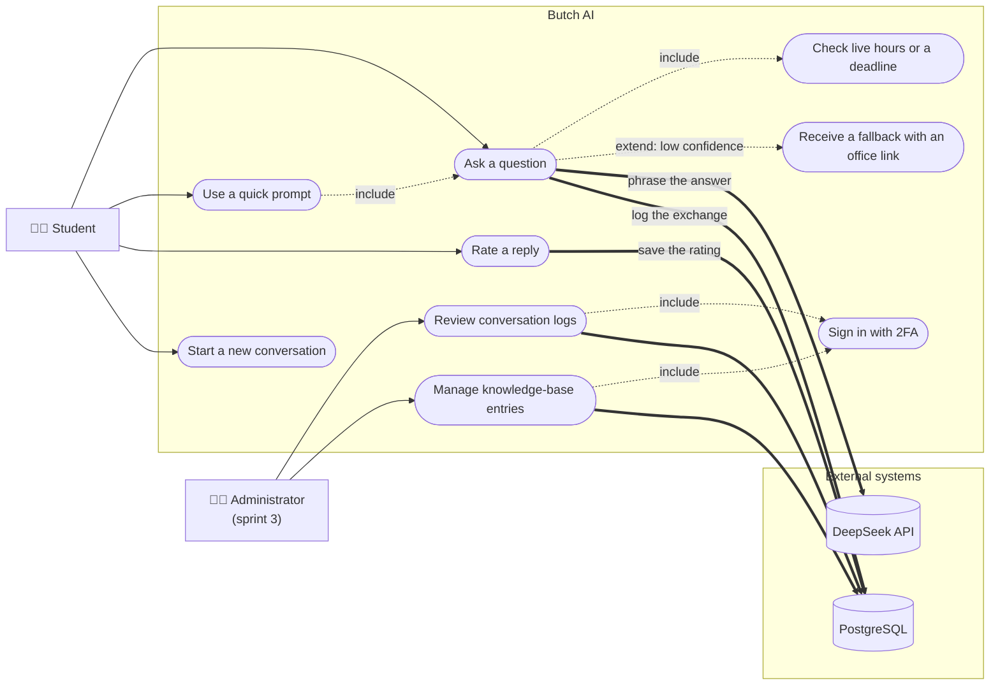
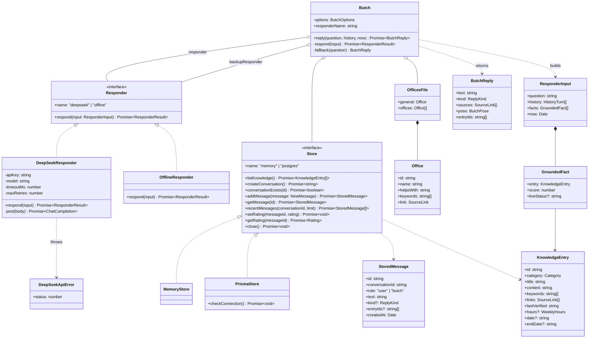
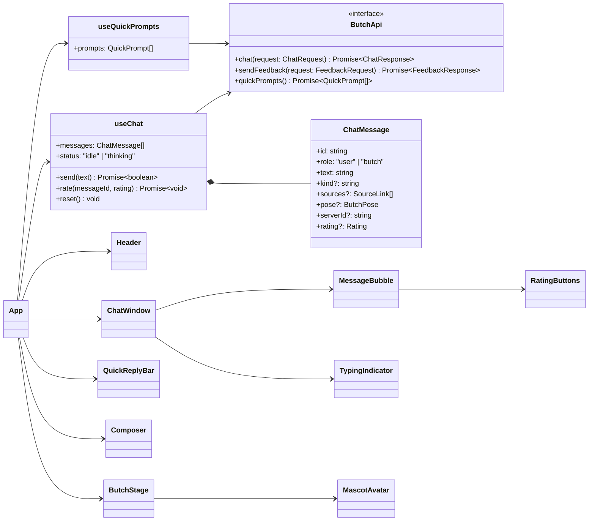
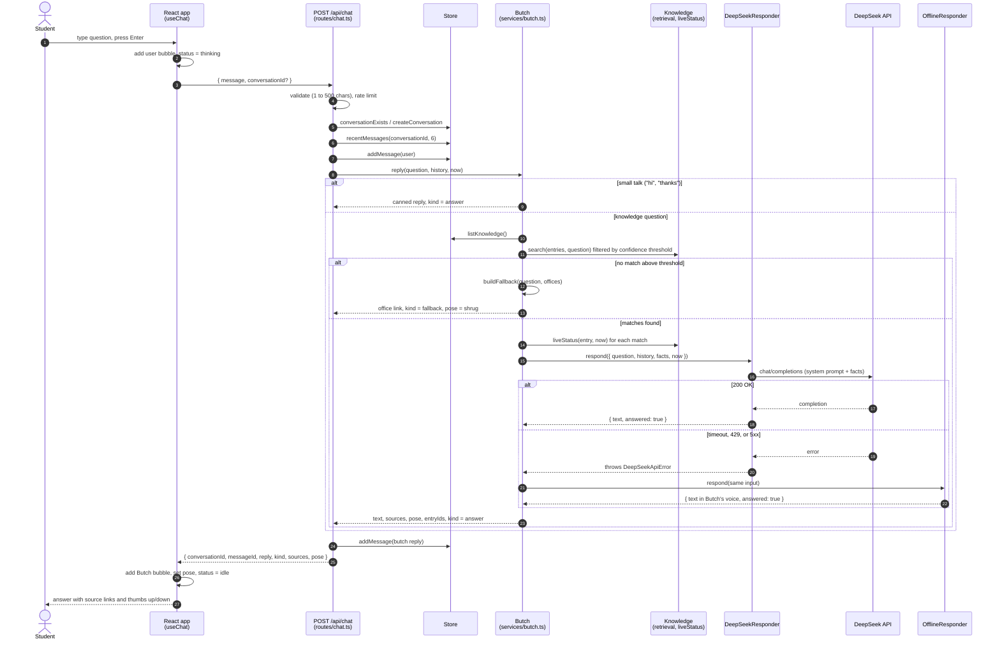
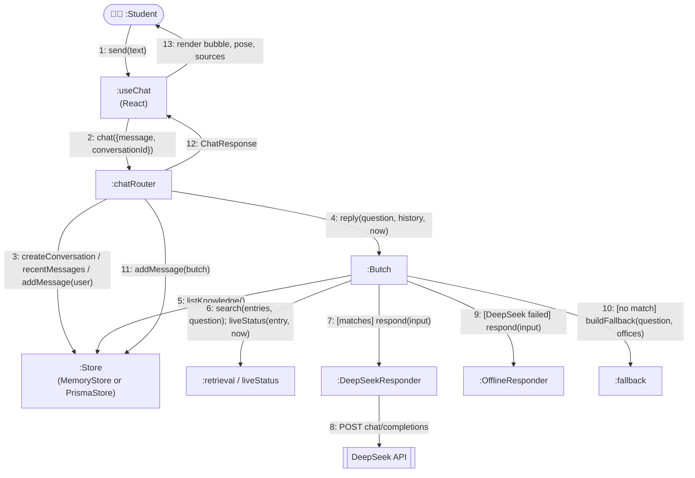
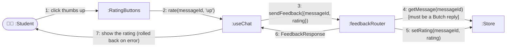

# UML diagrams

Use case, class, sequence, and collaboration diagrams for Butch AI as built in sprint 1. The
diagrams are Mermaid, so GitHub renders them in place. For slides, paste a block into
[mermaid.live](https://mermaid.live) and export PNG or SVG.

Rendered PNGs for the slide deck are in `docs/sprint-1/uml/` (made with mermaid-cli; regenerate them
after editing a diagram).

The prose version of the main flow is in [ARCHITECTURE.md §2](../ARCHITECTURE.md), "Follow one
question end to end". Class names below match the code in `server/src/` and `client/src/`.

## 1. Use case diagram

Actors: a **student** (current or prospective) using the chat, an **administrator** (sprint 3),
and two external systems the server depends on. Dotted arrows are `<<include>>` and `<<extend>>`
relationships; thick arrows show which use cases touch an external system.

| Use case                               | Story        | Status                           |
| -------------------------------------- | ------------ | -------------------------------- |
| Ask a question                         | US-01, US-11 | Done                             |
| Use a quick prompt                     | US-05        | Done                             |
| Check live hours or a deadline         | US-03, US-04 | Done                             |
| Receive a fallback with an office link | US-02        | Done                             |
| Rate a reply                           | US-07        | Done                             |
| Start a new conversation               | US-10        | Done                             |
| Review conversation logs               | US-08        | Logging done; screen in sprint 3 |
| Manage knowledge-base entries          | US-09        | Sprint 3                         |
| Sign in with 2FA                       | US-17        | Sprint 3                         |

## 2. Class diagram

The server is organized around one service, `Butch`, that depends on two interfaces: a
`Responder` (who writes the words) and a `Store` (where chats are saved). Each interface has two
implementations, which is how the same code runs with or without an API key and with or without
Docker. Types in `@butch/shared` are the API contract both client and server import.

Client side, the shape is smaller: the `App` component owns one `useChat` hook, which holds the
message list and talks to the server through the `ButchApi` interface.

## 3. Sequence diagram: asking a question

The happy path with the three branches the code takes: small talk, no confident match, and a
DeepSeek failure that falls back to the offline responder.

## 4. Collaboration diagram: asking a question

The same interaction as the sequence diagram, drawn as objects and numbered messages (UML calls
this a communication diagram). Numbers show order; `[cond]` marks a branch.

### Rating a reply (US-07)

