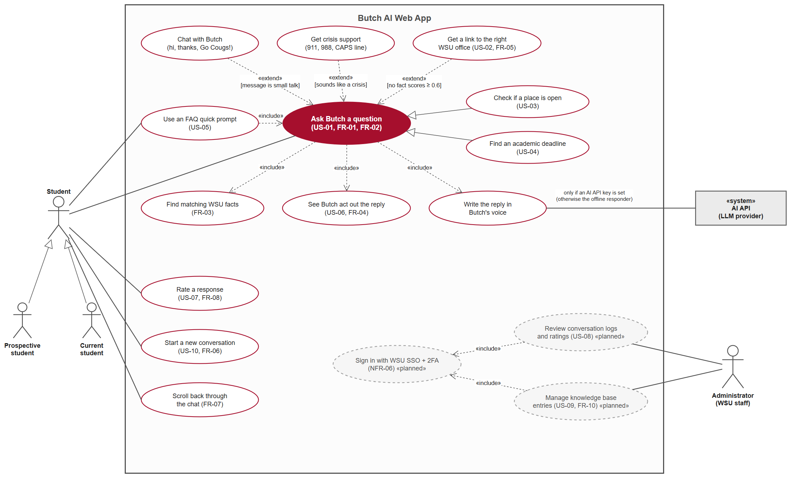
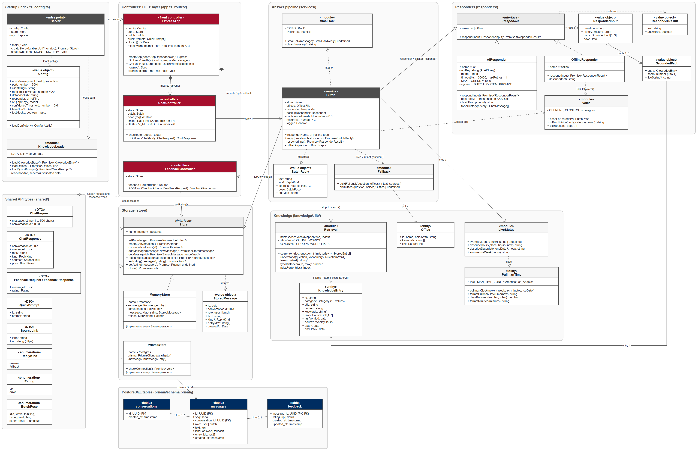
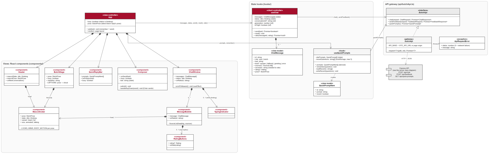
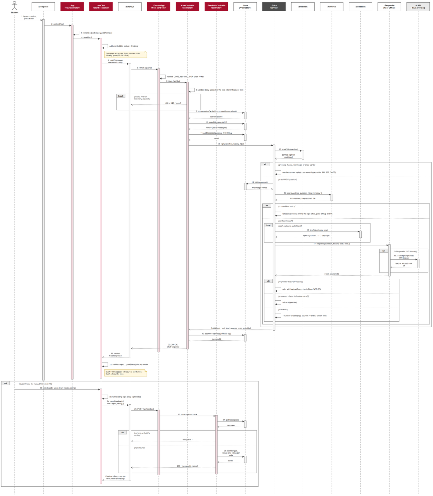
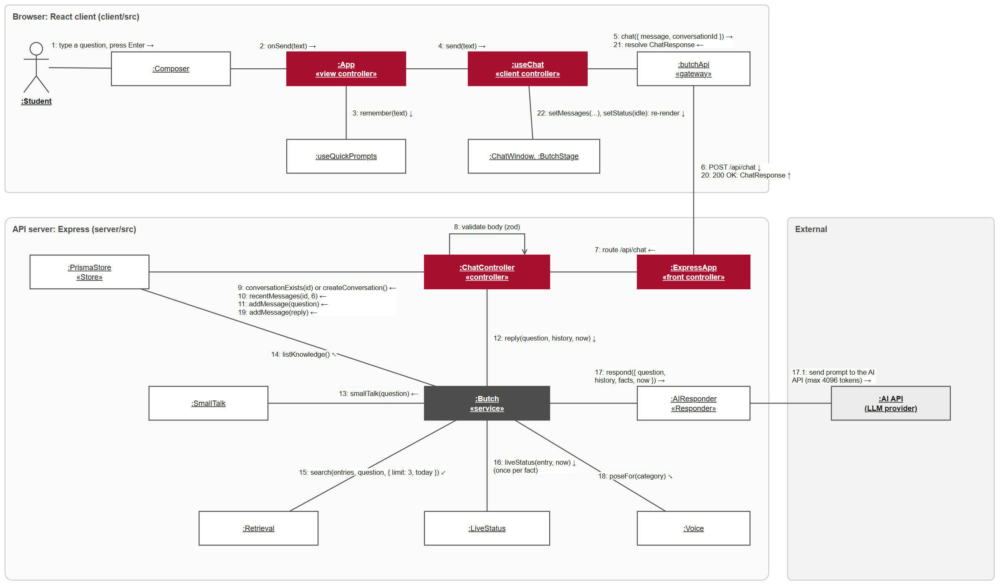

# UML diagrams

Use case, class, sequence, and collaboration diagrams for Butch AI as built in sprint 1, each with
a written description. The PNG exports are in `docs/sprint-1/uml/`. Diagrams 1 to 5 were drawn
by Kaiden; the class names match the code in `server/src/` and `client/src/`. The prose version
of the main flow is in [ARCHITECTURE.md §2](../ARCHITECTURE.md), "Follow one question end to end".

## 1. Use case diagram

**Actors.** A **Student** uses the chat; **Prospective student** and **Current student** are
specializations of it (same use cases, different questions). An **Administrator** (WSU staff)
owns the planned admin use cases. The **AI API** is a system actor the app calls to write
replies, but only when an API key is set; otherwise the offline responder writes them.

**Core use case: Ask Butch a question (US-01, FR-01, FR-02).** Everything else hangs off it.
It always _includes_ finding matching WSU facts (FR-03), writing the reply in Butch's voice,
and showing Butch act out the reply (US-06, FR-04). Using an FAQ quick prompt (US-05) includes
asking a question, since clicking a prompt sends it. Checking whether a place is open (US-03)
and finding an academic deadline (US-04) are specializations of asking a question: the same
flow, with live hours or a date added to the answer.

**Extensions with guards.** Chatting with Butch (greetings, thanks) extends asking when the
message is small talk; crisis support extends it when the message sounds like a crisis (911,
988, CAPS); getting a link to the right WSU office (US-02, FR-05) extends it when no fact
scores at or above the 0.6 confidence threshold.

**Other student use cases.** Rate a response (US-07, FR-08), start a new conversation (US-10,
FR-06), and scroll back through the chat (FR-07).

**Planned (dashed).** Review conversation logs and ratings (US-08) and manage knowledge-base
entries (US-09, FR-10) both include signing in with WSU SSO and 2FA (NFR-06). These are sprint
3 work; the logging half of US-08 is already done.

## 2. Class diagram: server

**Startup.** `Server` (`index.ts`) loads a `Config` value object from the environment, loads
the knowledge base, offices, and quick prompts through `KnowledgeLoader`, chooses a `Store`,
and builds the `Butch` service and the Express app.

**Controllers.** `ExpressApp` (`app.ts`) is the front controller: helmet, CORS, a global rate
limit, 10 KB JSON bodies, `GET /api/health`, `GET /api/quick-prompts`, and the two routers.
`ChatController` (`routes/chat.ts`) validates the body with zod, applies the per-IP chat rate
limit (20 per minute), loads the last 6 messages as history, and calls `Butch.reply`.
`FeedbackController` (`routes/feedback.ts`) checks the message is a Butch reply, then stores
the rating.

**Answer pipeline.** `Butch` (`services/butch.ts`) owns a `Store`, the offices file, a
`Responder`, a backup `Responder`, and the confidence threshold. `reply()` tries `SmallTalk`
first, then `Retrieval.search` (top 3 facts at or above 0.6), adds `LiveStatus` for hours and
dates, asks the responder to write the text, and falls back to `Fallback.buildFallback` when
there is no confident match or the responder cannot answer. The result is a `ButchReply` value
object with text, kind, sources, pose, and entry IDs.

**Responders.** `Responder` is an interface with two implementations. `AIResponder`
(`DeepSeekResponder` in the code) posts the system prompt, history, and grounded facts to the
LLM API with a 30 s timeout, max 4096 tokens, and one retry on 429 or 5xx. `OfflineResponder`
writes the matched entries in Butch's voice using `Voice`. If the AI responder throws, `Butch`
falls back to the backup responder (NFR-03).

**Storage.** `Store` is an interface with `MemoryStore` (tests and no-Docker setups) and
`PrismaStore` (PostgreSQL). The Prisma schema has three tables: `conversations`, `messages`,
and `feedback`, with one optional rating per message.

**Knowledge.** `KnowledgeEntry` is the entity every fact is validated into (zod schema in
`knowledge/schema.ts`): category, content, keywords, source links, `lastVerified`, and optional
hours or dates. `Office` is the entity the fallback points to.

**Shared API types.** The DTOs (`ChatRequest`, `ChatResponse`, `FeedbackRequest`, `QuickPrompt`,
`SourceLink`) and enumerations (`ReplyKind`, `Rating`, `ButchPose`) live in `shared/` and are
imported by both client and server.

## 3. Class diagram: client

**Views.** `App` is the view controller: it owns the page layout, tracks whether Butch is busy
and his latest pose, and renders the components in `components/`. `Header` (new-conversation
button and the mascot head), `ButchStage` (full-body mascot), `QuickReplyBar`, `Composer`
(text box; Enter sends), and `ChatWindow` (the message list, which renders a `MessageBubble`
per message, a `TypingIndicator` while thinking, and `RatingButtons` on real replies).
`MascotAvatar` draws Butch from a pose and state; the head and full-body variants share it.

**State hooks.** `useChat` is the client controller: it holds the `ChatMessage[]` list, the
`idle | thinking` status, and the conversation ID, and exposes `send`, `reset`, and `rate`.
`ChatMessage` is the view model, with an optional `serverId` (needed to rate) and `rating`.
`useQuickPrompts` merges the site-wide prompts with up to 5 of the user's recent questions
from `localStorage` and remembers each new question.

**API gateway.** `ButchApi` is an interface with `chat`, `sendFeedback`, and `quickPrompts`;
`butchApi` implements it over `fetch` against `VITE_API_URL` or the page origin, and throws
`ApiRequestError` with the HTTP status (0 for a network failure). Tests substitute a mock that
implements the same interface.

## 4. Sequence diagram: asking a question and rating the reply

**Steps 1 to 5 (browser).** The student types a question and presses Enter. `Composer` calls
`App.onSend`, which remembers the question for quick prompts and calls `useChat.send`. The hook
adds the user bubble, sets status to thinking (Butch switches to his thinking pose, FR-04), and
calls `butchApi.chat`.

**Steps 6 to 11 (server, before answering).** `POST /api/chat` passes through helmet, CORS,
the rate limit, and the JSON parser, then reaches `ChatController`, which validates the body
with zod. An invalid body or too many requests ends early with 400 or 429. Otherwise the
controller finds or creates the conversation, loads the last 6 messages as history, and logs
the question (FR-09).

**Steps 12 to 18 (answer pipeline).** `Butch.reply` first checks `SmallTalk`; a greeting,
thanks, or crisis message gets a canned reply. For a real question it loads the knowledge
entries, runs `Retrieval.search` (top 3, score at or above 0.6), and, with no confident match,
builds the office fallback (FR-05). With matches, it adds `LiveStatus` text for each fact
("open right now", "5 days ago"), then calls the responder. The AI responder sends the prompt
(max 4096 tokens); if it throws, `Butch` retries with the offline backup (NFR-03); if it
returns `answered: false` (refusal or cut-off), `Butch` falls back. On success it picks a pose
for the category and keeps up to 3 unique source links.

**Steps 19 to 22 (back to the browser).** The controller logs the reply, returns 200 with the
`ChatResponse`, and `useChat` adds the Butch bubble with sources and thumbs, sets status to
idle, and `App` re-renders with the new pose.

**Steps 23 to 28 (optional: rating, US-07).** Clicking thumbs up or down shows the rating right
away, then `POST /api/feedback` reaches `FeedbackController`, which loads the message, returns
404 if it is not one of Butch's replies, and otherwise stores one rating per reply. On an error
the hook undoes the optimistic rating.

## 5. Collaboration (communication) diagram: asking a question

The same interaction as the sequence diagram, drawn as objects with numbered messages. The
numbering matches the sequence diagram (1 to 22), so the two can be read side by side.

**Browser.** `:Composer` sends 1 to `:App`, which fans out 3 to `:useQuickPrompts` and 4 to
`:useChat`; `:useChat` calls `:butchApi` (5) and later re-renders `:ChatWindow` and
`:ButchStage` (22).

**API server.** `:butchApi` posts to `:ExpressApp` (6), which routes to `:ChatController` (7).
The controller validates (8), talks to `:PrismaStore` (9, 10, 11, 19), and calls `:Butch` (12).
`:Butch` collaborates with `:SmallTalk` (13), `:PrismaStore` (14), `:Retrieval` (15),
`:LiveStatus` (16), `:AIResponder` (17), and `:Voice` (18). The responder calls the external
AI API (17.1). The reply travels back as 20 (HTTP 200) and 21 (resolved promise).

**What the diagram shows that the sequence does not.** Which objects actually hold references
to which: `:Butch` is the hub of the answer pipeline, the controllers never touch the
knowledge modules directly, and the browser only ever talks to the server through
`:butchApi`.
