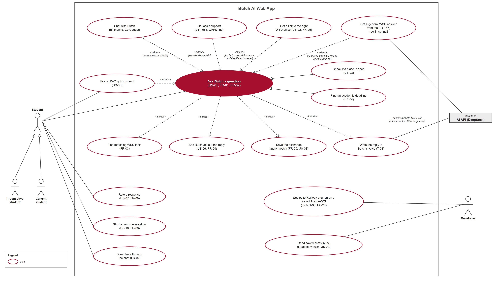
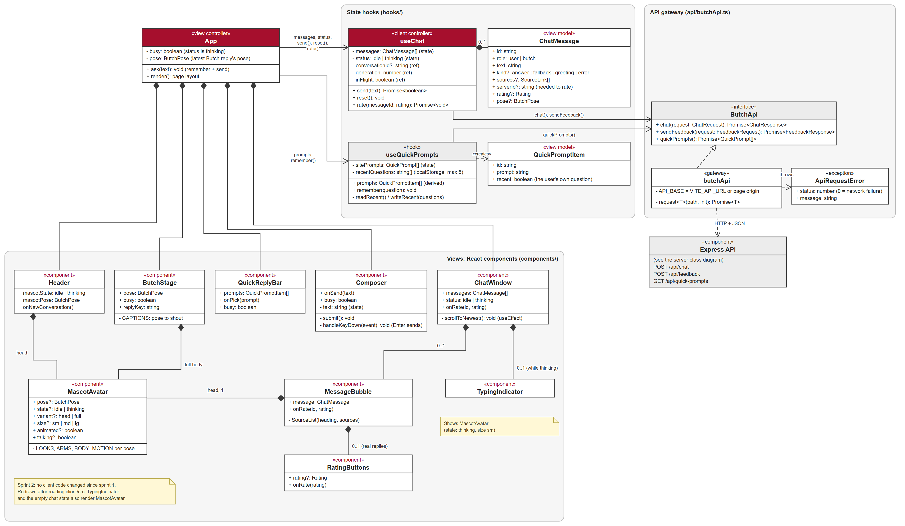
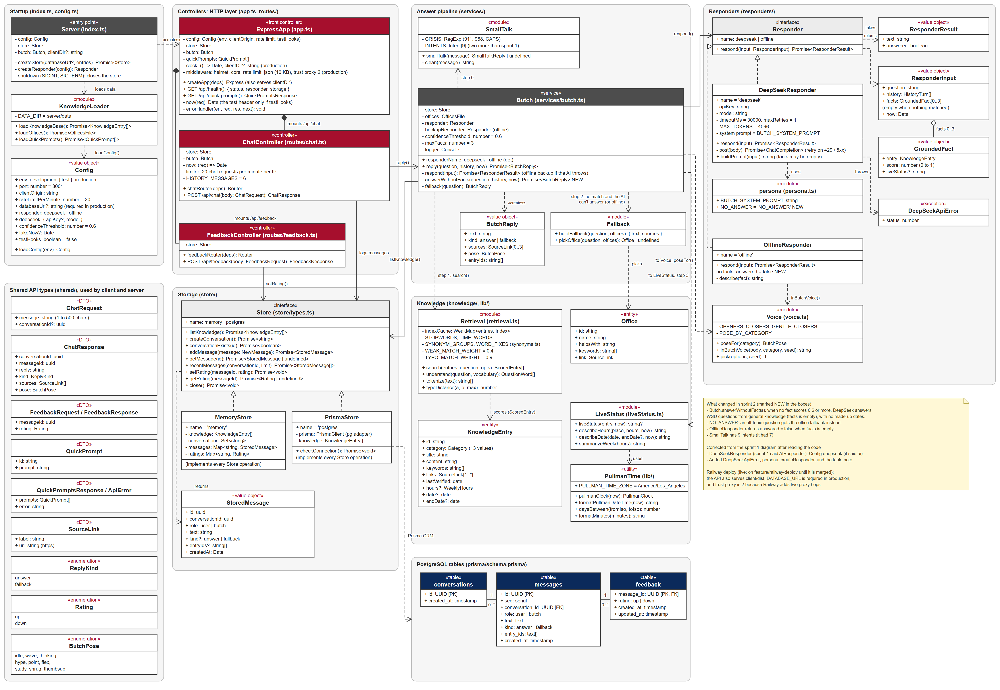
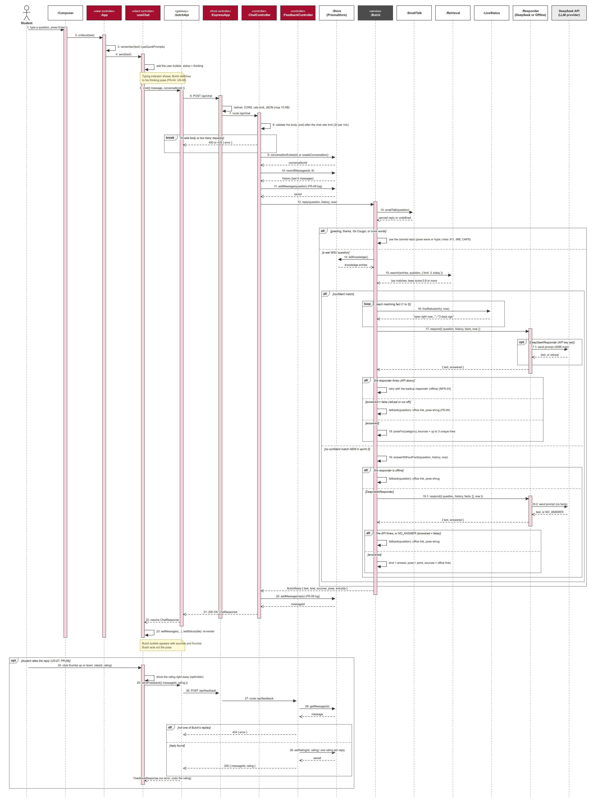
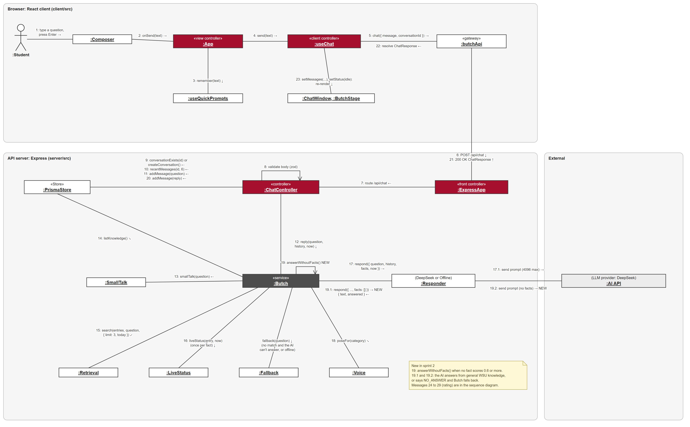
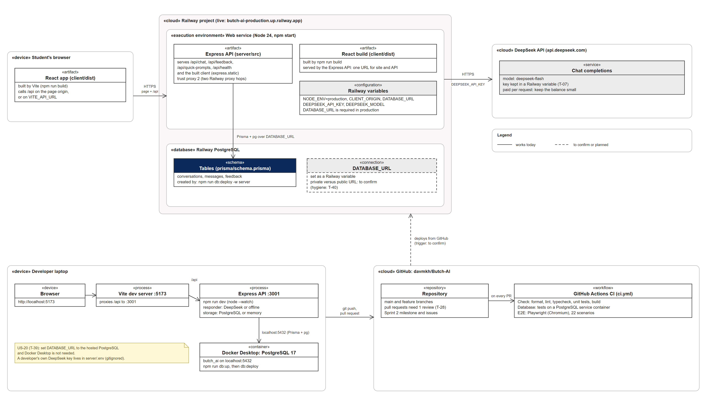

# UML diagrams (Sprint 2)

The sprint 2 versions of the Butch AI diagrams: use case, class (client and server), sequence,
collaboration, and a new deployment diagram. Each is a PNG (for documents and slides) in
[uml/](uml/). The sprint 1 versions and their descriptions stay in
[../sprint-1/UML.md](../sprint-1/UML.md).

## What changed since sprint 1

| Diagram          | What changed                                                                                                                                                                                                                                                                                      |
| ---------------- | ------------------------------------------------------------------------------------------------------------------------------------------------------------------------------------------------------------------------------------------------------------------------------------------------- |
| Use case         | The admin use cases and sign-in are gone (dropped in sprint 2 planning). New: "Get a general WSU answer from the AI" (T-47), "Save the exchange anonymously", and a Developer actor with "Deploy to Railway and run on a hosted PostgreSQL" (done) and "Read saved chats in the database viewer". |
| Class: client    | No client code changed. Redrawn after reading `client/src/`: `TypingIndicator` and the empty chat state also render `MascotAvatar`, which sprint 1 left out.                                                                                                                                      |
| Class: server    | New `Butch.answerWithoutFacts()`, `NO_ANSWER` in the persona, and `OfflineResponder` returning `answered = false` with no facts. `ResponderInput.facts` can now be empty. `SmallTalk` has 9 intents (7 before).                                                                                   |
| Sequence         | New branch for "no confident match" (messages 19, 19.1, 19.2). Later messages shift by one: the reply is logged as 20 (it was 19) and the rating is 24 to 29 (it was 23 to 28).                                                                                                                   |
| Collaboration    | The same three new messages, plus a `:Fallback` object.                                                                                                                                                                                                                                           |
| Deployment (new) | Shows where Butch runs: the browser, the live Railway project, the DeepSeek API, a developer laptop, and GitHub with CI.                                                                                                                                                                          |

## 1. Use case diagram



**Actors.** A **Student** (specialized as Prospective student and Current student) uses the chat.
The **AI API** (DeepSeek) is a system actor, used only when an API key is set. A **Developer**
deploys and runs Butch and reads the saved chats.

**Core use case: Ask Butch a question (US-01, FR-01, FR-02).** It always includes finding matching
WSU facts (FR-03), saving the exchange anonymously (FR-09), writing the reply in Butch's voice,
and showing Butch act out the reply (US-06). Checking whether a place is open (US-03) and finding
an academic deadline (US-04) are specializations; using an FAQ quick prompt (US-05) includes it.

**Extensions with guards.** Small talk and crisis support are unchanged. The two "no match"
extensions are now ordered: when no fact scores 0.6 or more and the AI is on, Butch **gets a general
WSU answer from the AI** (new, T-47); if the AI can't answer, or the app is offline, he **gets a
link to the right WSU office** (US-02, FR-05).

**Other student use cases.** Rate a response (US-07), start a new conversation (US-10), and scroll
back through the chat (FR-07).

**Developer use cases.** Deploying to Railway on a hosted PostgreSQL (T-35, T-39, US-20) is done:
the site has been live since Nov 3. Reading saved chats in the database viewer (US-08) replaces the
admin screens that were dropped.

## 2. Class diagram: client



The structure is unchanged from sprint 1 (see [../sprint-1/UML.md](../sprint-1/UML.md), section 3):
`App` is the view controller, `useChat` and `useQuickPrompts` hold the state, the components draw
the page, and `butchApi` talks to the Express API. In sprint 2 the same client is built into
`client/dist` and served by the API from the Railway site; `butchApi` calls the page origin (or
`VITE_API_URL` if the API ever moves).

## 3. Class diagram: server



**Controllers and startup.** `Server` loads `Config` and the knowledge data, picks a `Store`
(PostgreSQL when `DATABASE_URL` is set, otherwise memory), builds `Butch`, and creates
`ExpressApp`, which mounts `ChatController` and `FeedbackController`. For the Railway deploy, `ExpressApp`
also serves `client/dist` (`clientDir`, production only) and trusts two proxy hops. These changes are
on `feature/railway-deploy` until it is merged.

**Answer pipeline.** `Butch.reply()` tries `SmallTalk`, then `Retrieval.search()`. With a confident
match it adds `LiveStatus` text, asks the responder to write the reply, and falls back to the
backup responder if the AI throws. **New in sprint 2:** with no confident match it calls
`answerWithoutFacts()`. For an offline responder that goes straight to `Fallback`; otherwise
`DeepSeekResponder` is asked with an empty `facts` list and either answers from general WSU
knowledge (pose `point`, sources are the office links) or replies `NO_ANSWER`, which Butch turns
into the office fallback.

**Responders.** `Responder` is an interface with two implementations, `DeepSeekResponder` and
`OfflineResponder`. The system prompt and the `NO_ANSWER` constant live in `persona`;
`DeepSeekApiError` is thrown for a non-2xx API reply.

**Storage and tables.** `Store` has `MemoryStore` and `PrismaStore`. The three tables are
`conversations`, `messages`, and `feedback`. On Railway, `DATABASE_URL` points at the Railway
PostgreSQL instead of the Docker one (T-39), and the server refuses to start in production without it.

## 4. Sequence diagram: asking a question and rating the reply



Steps 1 to 12 are the same as sprint 1: the student types, the client sends `POST /api/chat`, the
controller validates it (400 or 429 on a bad request), finds or creates the conversation, loads the
last 6 messages, logs the question, and calls `Butch.reply`. Step 13 is `SmallTalk`.

For a real question, `Butch` loads the knowledge (14) and searches it (15). In the **confident
match** branch it adds live status for each fact (16), calls the responder (17, and 17.1 to the AI),
and handles a throw, a refusal, or a good answer (18). **New:** in the **no confident match**
branch it runs `answerWithoutFacts` (19). If the responder is offline it falls back; otherwise it
asks the AI with no facts (19.1, 19.2) and either falls back (API error or `NO_ANSWER`) or returns
an answer with `kind = answer` and `pose = point`.

Then the controller logs the reply (20) and returns `200 OK` (21), the client resolves it (22) and
re-renders (23). Steps 24 to 29 are the optional rating (US-07): the client shows it right away, the
feedback controller checks the message is one of Butch's replies (404 if not) and stores one rating
per reply.

## 5. Collaboration diagram: asking a question



The same interaction as the sequence diagram, drawn as objects with numbered links, and numbered the
same way. `:Butch` is the hub of the answer pipeline. New in sprint 2: the self-message 19, the
messages 19.1 and 19.2 to the responder and the AI, and the `:Fallback` object that `:Butch` uses
when nothing matches and the AI can't answer.

## 6. Deployment diagram (new)



Shows where Butch AI runs. **Solid borders work today; dashed borders are still to confirm or planned.**
A student's browser loads the React app and calls the API over HTTPS. The Railway project (T-35,
T-39, T-40) holds one web service that runs the Express API and serves the built client, plus a
PostgreSQL, with secrets set as Railway variables. The site is live at
https://butch-ai-production.up.railway.app. The API calls the
DeepSeek API over HTTPS. A developer's laptop runs Vite and Express with a Docker PostgreSQL today;
with the hosted database (US-20) Docker Desktop is no longer needed. GitHub holds the repository and
runs CI (check, database, and end-to-end jobs); how Railway is triggered to deploy is still to confirm
with Dav, and so is whether the database uses Railway's private URL (T-40).

## How the diagrams were made

Kaiden gave the structure and the insights: what each diagram should include, point to, and extend.
He supplied rough drafts of the sprint 2 diagrams, and said what to add for sprint 2
and what to drop (the admin features and their use cases), as well as additional feedback and planning asking for additional advice and topics to add/remove from the diagrams.

Claude then produced the sprint 2 versions. It read the current
code (`server/src`, `client/src`, `shared/`, the Prisma schema, and the CI workflow) and the
sprint 2 documents, and wrote Python scripts that draw each diagram and render the PNG
with Chrome. The scripts are in [uml/source/](uml/source/), so a diagram can be changed by editing
its script and rebuilding.

Claude checked each box, field, and method against the code, and corrected these differences from
the sprint 1 diagrams: `DeepSeekResponder` (sprint 1 said `AIResponder`), `Config.deepseek` (it said
`ai`), the missing `DeepSeekApiError`, `persona`, and `createResponder`, the missing
`MascotAvatar` links from `TypingIndicator` and the empty chat state, and the `SmallTalk` intent
count (9, not 7).

## Rebuilding the diagrams

```bash
python docs/sprint-2/uml/source/build.py
```
